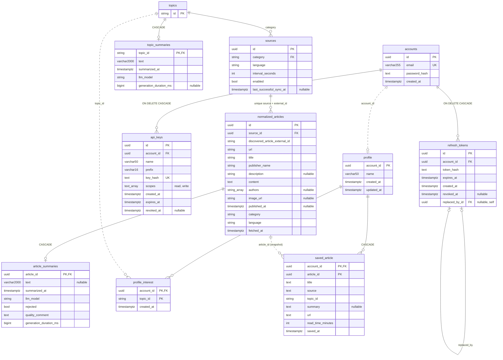

*This project has been created as part of the 42 curriculum by ceslinge, jgossard, mzhou, jwuille, amdevezi.*

# Brief.ly

> Your news, summarised by AI, around the topics you follow.

## Description

**Brief.ly** helps people stay informed without the information overload. It generates concise summaries
of articles and serves them according to the topics each user cares about, so they can
get the essentials in minutes instead of reading full articles.

**Brief.ly** is a web application for anyone who wants a personalised,
time-efficient way to follow the news and topics they care about. After signing in,
users complete their profile with their name and interests and land on their dashboard:
the date, a short quote and a greeting, followed by summaries of articles matching their interests.
They can read a summary, save it to read later, or ask the AI for a digest of their topics
and follow-up questions.
The project is split into microservices behind a Traefik gateway: Identity, Personalization,
Morning Briefing, Content Management and AI Processing.

**Key features**
- **Authentication & onboarding**: sign up, sign in, then set your name and topics of interest.
- **Morning Briefing dashboard**: personalised greeting, date and quote, followed by your summaries.
  Articles without a summary yet are hidden.
- **AI-generated summaries**: articles and topics are summarised by AI Processing (Ollama) and stored in Content Management.
- **AI digest and chat**: from the Brief page, the "Ask the AI" panel writes a short or long digest
  of your topics, with an optional focus, and answers follow-up questions. The answer is streamed
  as it is written and can be stopped.
- **Topic-based recommendations**: the feed is built from the interests chosen by the user.
- **Read or save for later**: open a summary, or save the article to your reading list, then search,
  filter and sort it.
- **Public API**: third-party programs can access the data with an API key, documented with Swagger UI.
- **Responsive layout**: the dashboard works on phones as well as on desktop.
- **Monitoring and backups**: Prometheus and Grafana dashboards with alerts, and encrypted backups of
  the databases and metrics that can be restored into a fresh VM.

## Instructions

The recommended way
is the **development VM** (Ubuntu 24.04 under QEMU), which installs Docker and Compose
for you and keeps the stack isolated from your machine.

### Prerequisites

**Option A: Development VM (recommended)**

On your host:
- Linux (x86_64 or ARM64) or an Apple Silicon Mac
- QEMU (`qemu-system-x86_64` or `qemu-system-aarch64`), `qemu-img`
- `rsync`, `ssh`, `ssh-keygen`, `ssh-add`, `python3`, `lsof`
- Linux only: access to `/dev/kvm`
- An SSH key pair (the public key is copied into the VM)
- GNU Make and Git
- [Ollama](https://docs.ollama.com/quickstart), installed on the host: the AI summaries and the digest
  use it (the VM reaches it at `10.0.2.2:11434`)
- About 60 GiB of free disk space, and at least 6 GiB of RAM available for the VM
  (4 vCPUs and 6 GiB by default, configurable with `VM_CPUS` and `VM_MEMORY`)
- Internet access on first launch (downloads Ubuntu, installs Docker and pulls the Ollama model)

Inside the VM (installed automatically, pinned versions):
- Docker Engine 29.9.0 and Docker Compose plugin 5.6.0

A ready-made check script for the host tools is in
[README.dev.vm.md](README.dev.vm.md#1-check-required-tools).

**Option B: Docker on your host**
- Docker Engine 29.9.0+ with the Docker Compose plugin 5.6.0+ (`docker compose`)
- GNU Make and Git

**Only if you run processes outside containers** (see [README.dev.md](README.dev.md)):
- Node.js 24.18.0 and npm 11
- Python 3.14 and `uv` 0.12 (the images pin 0.12.15)

**Optional**
- [mkcert](https://github.com/FiloSottile/mkcert) for a locally trusted HTTPS certificate
- A NewsAPI key, only needed to ingest new articles (`make ingest-vm`)

### Setup

1. Clone the repository:
   ```bash
   git clone <repo-url> && cd ft_transcendence
   ```

2. Create the root configuration (the Makefile reads it, so it must exist before any `make` command):
   ```bash
   cp .env.example .env
   ```
   In `.env`, check:
   - `SSH_PUBLIC_KEY`: the path to your public key.
   - `PROJECT_STORAGE_DIR`: where the VM disk and the backups are stored. The default,
     `/goinfre/$(USER)/transcendence`, suits the 42 computers; elsewhere, pick a folder with
     enough space (see [README.dev.vm.md](README.dev.vm.md#4-choose-where-to-store-the-vm)).

3. Create each service's `.env` from its `.env.example`:
   ```bash
   make init-env
   ```
   This overwrites existing `.env` files, root included: run it once, before editing them.

4. Secrets in `shared/secrets/` (JWT keys, service client secrets, database and Grafana passwords,
   HTTPS certificate) are generated automatically by `make secrets`, which the VM commands run.
   Only the NewsAPI key is manual. Write it in `shared/secrets/news_api_key` (git-ignored):
   ```bash
   install -m 600 /dev/null shared/secrets/news_api_key
   # then paste your NewsAPI key into that file
   ```

5. Start everything with one command:
   ```bash
   make all
   ```
   It creates the VM if none exists (first time only: it asks for confirmation, downloads Ubuntu
   and installs Docker), starts the application and monitoring inside it, ingests articles,
   starts Ollama on the host with the model set in `srcs/services/ai-processing/.env`
   (`OLLAMA_MODEL`, `gemma2:2b` by default), then writes the summaries.
   Plain `make` only lists the available commands.

6. Open `https://localhost:8443` and accept the self-signed certificate warning once
   (or use mkcert, see [README.docker.md](README.docker.md#https-certificate)).
   Stop the VM with `make stop-vm`, and Ollama with `make ollama-down`.

### Step by step

`make all` runs these commands in order; run them one by one to see each step, or to repeat one:

| Step | Command | What it does |
| --- | --- | --- |
| 1 | `make vm-full-stack` | Start the VM, then the application and monitoring inside it (`make vm-app`: the application only) |
| 2 | `make ingest-vm` | Fetch articles from NewsAPI and store them in Content Management |
| 3 | `make ollama` | Start Ollama on the host and pull the model |
| 4 | `make summarize` | Run the AI worker: summarise the new articles, then each topic |

Then open `https://localhost:8443`, sign up, choose your interests and read your Morning Briefing.
The "Ask the AI" button on the Brief page opens the digest panel.

### Production

```bash
make prod
```

Builds and runs the production images inside the VM (the frontend served by nginx, no source mounts,
no development ports).

## Environment variables

The root `.env` file contains shared configuration used by Docker Compose and the Makefile.
Each backend service has its own `.env` (`srcs/services/*/.env`, created from its `.env.example`
by `make init-env`).

> **Warning**
> Sensitive credentials, API keys, JWT keys and TLS certificates are managed separately through
> Docker Compose secrets in `shared/secrets/`. They should **never** be committed to Git.

For local development outside containers, including frontend and backend setup, see
[README.dev.md](README.dev.md). For the VM, see [README.dev.vm.md](README.dev.vm.md); for Docker
on the host, see [README.docker.md](README.docker.md).

## Useful commands

The following commands cover the main project workflows:

| Command | Description |
|---|---|
| `make all` | Create the VM if needed, start everything, ingest and summarise |
| `make vm-full-stack` | Start the application and monitoring inside the VM |
| `make vm-app` | Start only the application inside the VM |
| `make docker` | Start the application and monitoring with Docker on the host |
| `make prod` | Build and run the production stack inside the VM |
| `make ingest-vm` | Scrape and ingest articles from NewsAPI (VM) |
| `make ollama` / `make ollama-down` | Start / stop Ollama on the host |
| `make summarize` | Generate the article and topic summaries with Ollama |
| `make clear-articles-vm` | Delete the articles, their summaries and saved snapshots (asks first; users are kept) |
| `make backup` | Create and verify an encrypted backup on the host |
| `make backup-restore BACKUP_SET=<id>` | Recreate the VM and restore a backup into it |
| `make down-vm` | Stop the containers in the VM |
| `make stop-vm` | Shut down the VM |
| `make fclean-vm` | Reset the VM's database data and remove the project images (asks first) |

For the complete list of available commands and their descriptions, run:

```bash
make
```

## Team Information

| Member | Role(s) | Responsibilities |
| --- | --- | --- |
| `amdevezi` | Developer | Frontend architecture, UI development, component implementation, API integration and frontend testing.|
| `jgossard` | Technical Lead / Developer | Technical coordination and backend architecture, microservices structure and development standards, Identity service and authentication, shared packages, database management (SQLAlchemy and Alembic), Traefik API Gateway and HTTPS, service-to-service authentication, Public API, and the AI digest and chat.|
| `jwuille` | PM | Project planning and team coordination, task management and progress tracking, content-management service, news ingestion pipeline, CI workflows, containerization and observability.|
| `mzhou` | PO / Developer | Product feature development and technical implementation, AI processing and summarization (Ollama), automated content enrichment, monitoring and observability (Prometheus and Grafana), backups and disaster recovery, development infrastructure and VM management (QEMU), Docker and database environment setup.|
| `ceslinge` | Developer | Frontend architecture and development (React, TypeScript, Tailwind CSS), custom design system and reusable UI components, personalization and daily briefing features, backend service integration, advanced search and notifications.|

## Project Management

Work is organised around GitHub Issues, Pull Requests and Projects.

- **Work organisation:** Tasks are defined as GitHub Issues and assigned to team members according to project features and technical areas.
- **Tools:** GitHub Issues and Projects are used to organise and track tasks, while Pull Requests are used for code reviews and integration.
- **Communication:** Team discussions and daily coordination meetings take place on Discord, using a dedicated project server organised into channels and threads.
- **Git workflow:** Development follows a feature-branch workflow, with commits, pull requests, code reviews and rebasing before integration.

For more details:
- [Git Workflow](docs/conventions/git-workflow.md)
- [Git Conventions](docs/conventions/git-conventions.md)
- [Commit Message Convention](docs/conventions/commits.md)

## Technical Stack

| Layer | Technology | Why |
| --- | --- | --- |
| Frontend | React 19, TypeScript 6, Vite 8, Tailwind CSS 4, React Router 7 | Modern component-based UI, static typing, fast development and responsive styling |
| Backend | Python 3.14, FastAPI | High-performance REST APIs and independent microservices |
| Database | PostgreSQL 18 | Relational data storage with transactional consistency |
| AI Processing Database | PostgreSQL 18 with pgvector extension | Dedicated database for AI Processing service data |
| ORM / Migrations | SQLAlchemy, Alembic | Database access and version-controlled schema migrations |
| AI | Ollama (local model, `gemma2:2b` by default) | Summaries and the streamed digest and chat, without sending data to an external provider |
| Gateway | Traefik v3 | HTTPS, allowlist routing, rate limiting, API key verification (ForwardAuth) |
| Infrastructure | Docker Compose, QEMU/KVM | Container orchestration and isolated development/production environments |
| Monitoring | Prometheus, Grafana, Pushgateway, Blackbox Exporter | Metrics, dashboards, alerts, and HTTPS probes of the running application |
| Python Tooling | uv, Ruff, pytest, ty | Dependency management, linting, formatting, testing and static type checking |
| Frontend Tooling | npm, ESLint, Prettier, Vitest | Dependency management, code quality, formatting and testing |
| Authentication | JWT (RS256) | User sessions (short-lived access token, refresh token in an HttpOnly cookie) and service-to-service authentication |

## Architecture

The application follows a microservices architecture with five independent backend services:

- **Identity:** Authentication, account management and API keys.
- **Personalization:** User preferences (profile, topics) and saved articles.
- **Content Management:** Content ingestion, storage and management, with the AI summaries.
- **Morning Briefing:** Personalised daily briefings.
- **AI Processing:** A worker that writes the summaries back to Content Management, and the streamed
  digest and chat routes.

The browser talks only to the Traefik gateway, over HTTPS (`https://localhost:8443`). The gateway
serves the frontend and routes `/api/<service>/...` to Identity, Personalization, Morning Briefing and
AI Processing; Content Management and internal routes are never exposed. Services verify tokens
locally with Identity's public key, communicate through internal HTTP APIs, and each owns its database.
Monitoring runs as a separate Compose project (`compose.monitoring.yaml`) on the same networks.

For more details, see the [Architecture Documentation](docs/architecture/00_README.md).

Additional documentation:
- [Project Architecture](docs/architecture/01_project-architecture.md)
- [System Overview](docs/architecture/02_overview.md)
- [Backend Services](docs/architecture/03_service.md)
- [Backend Structure](docs/architecture/04_backend-service-structure.md)
- [Frontend Structure](docs/architecture/05_frontend-structure.md)
- [Disaster Recovery](docs/disaster-recovery.md)

## API Documentation

Detailed API documentation is available for each backend service.

See the [API Documentation Overview](docs/api/README.md).

- [API Conventions](docs/api/00_conventions.md)
- [Identity API](docs/api/01_identity.md)
- [Personalization API](docs/api/02_personalization.md)
- [Morning Briefing API](docs/api/03_morning-briefing.md)
- [Content Management API](docs/api/04_content-management.md)
- [AI Processing API](docs/api/05_ai-processing.md)
- [Service-to-Service Communication](docs/api/06_service-to-service.md)

The Public API is documented with Swagger UI at
[https://localhost:8443/public/v1/docs](https://localhost:8443/public/v1/docs) (no key needed to read it).

## Database Schema



AI Processing's own database (pgvector) holds no table yet: the summaries live in Content Management
(ADR-0010), and the digest stores nothing.

## Architectural Decisions

Technical and architectural decisions are documented using Architecture Decision Records (ADRs).

See the [ADR directory](docs/adr/) for the complete list of decisions.

Some important decisions include:

- [Git Flow Branching Strategy](docs/adr/0001-adopt-git-flow-branching-strategy.md)
- [Rebase over Merge](docs/adr/0002-use-rebase-over-merge-for-branch-integration.md)
- [Clean Architecture](docs/adr/0004-adopt-clean-architecture-for-backend-services-and-feature-based-architecture-for-frontend.md)
- [Traefik Gateway and Network Architecture](docs/adr/0006-use-traefik-gateway-with-tls-termination-and-two-networks.md)
- [Authentication and Token Model](docs/adr/0007-adopt-rs256-token-model-and-cookie-based-browser-session.md)
- [Service-to-Service Authentication](docs/adr/0008-authenticate-service-to-service-calls-with-forwarded-and-service-tokens.md)
- [Public API and API Keys](docs/adr/0009-expose-a-public-api-with-api-keys-verified-by-the-gateway.md)
- [AI Summaries as an Enrichment Pipeline](docs/adr/0010-store-ai-summaries-in-content-management-as-an-enrichment-pipeline.md)
- [On-Demand Digest and Chat](docs/adr/0011-generate-an-on-demand-digest-and-chat-in-ai-processing.md)


## Features List

| Feature | Description | Team member(s) |
|---|---|---|
| Registration / Login | User account creation and authentication | Implemented by amdevezi and jgossard |
| Custom Design System | Reusable UI components, shared colors, typography, icons and design tokens, showcased on https://localhost:8443/designpage | Implemented by ceslinge and amdevezi |
| JWT Authentication | Secure authentication using access and refresh tokens | Implemented by jgossard |
| Public API Keys | Create and manage API keys for public API access, with a link to the API documentation | Implemented by amdevezi and jgossard |
| Content Management | Content ingestion, storage and management | Implemented by jwuille |
| Personalization | Personalised content based on user preferences | Implemented by ceslinge and amdevezi |
| Daily Briefing | Generate personalised daily news briefings | Implemented by ceslinge |
| AI Processing | AI-powered content processing and summarization | Implemented by mzhou and jwuille |
| AI Digest and Chat | Streamed digest of the user's topics and follow-up questions, from the Brief page | Implemented by jgossard |
| Responsive Layout | Dashboard usable on phones (top bar, scrollable tabs) | Implemented by jgossard and ceslinge |
| Prometheus and Grafana | Monitoring system: metrics, dashboards, alerts, HTTPS probes | Implemented by mzhou and jwuille |
| Backups and Recovery | Encrypted host backups of the databases and metrics, restored into a fresh VM | Implemented by mzhou |

## Modules

### Summary

| # | Module | Category | Type | Points |
| --- | --- | --- | --- | --- |
| 1 | Frontend framework | Web | Minor | 1 |
| 2 | Backend framework | Web | Minor | 1 |
| 3 | Public API (API key, rate limiting, docs, 7 endpoints) | Web | Major | 2 |
| 4 | Notification system (create/update/delete actions) | Web | Minor | 1 |
| 5 | Custom design system (10+ reusable components) | Web | Minor | 1 |
| 6 | Advanced search (keyword search, source and topic filters, reading-time sorting, pagination) | Web | Minor | 1 |
| 7 | Support for additional browsers | Accessibility | Minor | 1 |
| 8 | ORM (SQLAlchemy + Alembic) | Web | Minor | 1 |
| 9 | Monitoring with Prometheus and Grafana | DevOps | Major | 2 |
| 10 | Backend as microservices | DevOps | Major | 2 |
| 11 | LLM system interface (streamed digest and chat) | Artificial Intelligence | Major | 2 |
| 12 | Health checks, backups and disaster recovery | DevOps | Minor | 1 |
| 13 | News ingestion + AI enrichment + DDD (custom) | Module of choice | Major | 2 |
| 14 | API Gateway | Module of choice | Major | 2 |
| 15 | CI (custom) | Module of choice | Minor | 1 |
| | **Total** | | | **21** |


### Details

| Module | Justification | Implementation | Member(s) |
| --- | --- | --- | --- |
| Frontend framework | React provides a component-based architecture, reusable UI elements, and efficient state management. | React + TypeScript + Vite + Tailwind | ceslinge and amdevezi  |
| Backend framework | FastAPI provides automatic OpenAPI documentation and request validation with Pydantic, simplifying API development and ensuring consistent request handling. | FastAPI, one app per service | ceslinge, jgossard, jwuille and mzhou |
| Public API | Provides secure and controlled access to application resources for external consumers. | 7 endpoints under `/public/v1`: `GET /topics`, `GET /me/profile`, `PUT /me/profile`, `GET /me/saved-articles`, `POST /me/saved-articles/{article_id}`, `DELETE /me/saved-articles/{article_id}`, `GET /morning-briefing`. Authentication through API keys (`read` and `write` scopes) using Traefik ForwardAuth and Identity's phantom token pattern. API keys have a 48-hour validity period, with a maximum of 5 active keys per account. Gateway rate limiting: 20 requests/second per IP and 5 requests/second per API key. Swagger documentation: [Public API Docs](https://localhost:8443/public/v1/docs). | jgossard and amdevezi |
| Notifications | Improves user experience by providing immediate feedback on important application actions. | Notification component, triggered on every create/update/delete | ceslinge |
| Design system | Ensures visual consistency, maintainability, and UI reusability across the application. | 21 reusable components (Button, Division, Text, Tabs, ...), color palette, typography, icons. Visual showcase: [Design System Page](https://localhost:8443/designpage) | ceslinge and amdevezi |
| Advanced search | Helps users efficiently find relevant saved content through keyword search, source and topic filtering, reading-time sorting, and pagination. | Saved articles page: keyword search, filters by source and topic, sorting by reading time (not date), and pagination. | ceslinge |
| Additional browsers | Improves accessibility and compatibility for users across different browsers. | Tested on Firefox, Google Chrome, Safari, Brave | ceslinge, amdevezi and jgossard |
| ORM | Provides structured database access, simplifies database operations, and improves maintainability through object-relational mapping and version-controlled schema migrations. | SQLAlchemy for ORM and database interactions; Alembic for database schema migrations | jgossard |
| Monitoring | Enables observability of the system through metrics collection, visualization, and alerting. | Prometheus, Pushgateway (AI worker metrics) and Blackbox Exporter (HTTPS probes of the gateway), custom Grafana dashboards, alert rules, secured Grafana access, in their own Compose project (`compose.monitoring.yaml`). Grafana: http://127.0.0.1:3000/, user `admin`, password in `shared/secrets/grafana_admin_password`. See [README.docker.md](README.docker.md#independent-monitoring). | mzhou and jwuille |
| Microservices | Single responsibility per service, loose coupling | identity, personalization, content-management, morning-briefing, ai-processing | mzhou, jgossard, ceslinge, jwuille |
| LLM system interface | Lets users ask the AI about their own news, instead of only reading pre-written summaries. | `POST /digest` and `POST /digest/chat` in AI Processing: text generated from the user's input (length, focus, questions) and their topics' summaries, streamed as Server-Sent Events from a local Ollama model and shown live in the "Ask the AI" panel. Error handling (stream errors, model unavailable, validation), prompt-injection defenses, and gateway rate limits (6 answers a minute per session, at most 2 being written at once). See [ADR-0011](docs/adr/0011-generate-an-on-demand-digest-and-chat-in-ai-processing.md). | jgossard |
| Health checks, backups and disaster recovery | Detects a failing component quickly, and makes sure losing the VM does not mean losing the users' data. | **Health checks:** every service has a `/health` route that checks its database (`503 SERVICE_UNAVAILABLE` when unreachable); Docker Compose health checks on the services, the gateway (`traefik healthcheck --ping`) and both databases (`pg_isready`), every 10 s, so a service starts only once its database is healthy and its migrations have run. **Status monitoring:** Blackbox Exporter probes the gateway over HTTPS and each service's `/health`; Grafana shows availability and raises alerts (API target down, gateway HTTPS probe failed, elevated 5xx rate, AI worker last run failed). **Backups:** `make backup` dumps every database and the cluster roles of both PostgreSQL instances, plus a Prometheus snapshot, into one set stored on the host (outside the VM), encrypted with AES-256-CBC (PBKDF2) and authenticated with an HMAC, then verified. `make backup-schedule` repeats it at an interval; retention keeps 7 daily, 4 weekly and 3 monthly sets (`make backup-prune`). **Disaster recovery:** `make backup-restore BACKUP_SET=<id>` verifies the set, recreates the VM, restores the databases and metrics into it and starts the stack. Targets: at most 24 h of data lost (RPO), service back within 4 h (RTO); runbook and restore drill in [docs/disaster-recovery.md](docs/disaster-recovery.md). | mzhou and jwuille |
| News ingestion + AI enrichment + DDD (custom Major) | Retrieves external news articles and enriches them with AI-generated summaries, while keeping business logic separated from infrastructure concerns. | NewsAPI integration for article retrieval, manual ingestion through `make ingest-vm`, AI-powered summarization through Ollama (`make summarize`), and DDD layers (domain, application, infrastructure, API).| jgossard, jwuille and mzhou |
| CI (custom Minor) | Automates code quality checks and testing on pull requests to improve code reliability and maintainability. | GitHub Actions on every PR: lint, format, typecheck and tests, only for the services that changed. | jwuille |
| API gateway | Implementation of Traefik as reverse proxy and API gateway. | Traefik v3: HTTPS termination (HTTP redirected), allowlist routing with prefix stripping, `edge` and `backend` networks so internal services are never reachable from outside, rate limits, and API key verification (ForwardAuth) for the Public API. | jgossard |


## Individual Contributions

### jgossard

**Implemented:**

- Set up the project foundations: architecture and development conventions (ADRs, clean architecture, git workflow), the backend service structure (FastAPI, SQLAlchemy, Alembic) and the five microservices.
- Built the Identity service: registration, login, RS256 JWT access tokens and rotating refresh tokens stored in an HttpOnly cookie with a CSRF guard.
- Created the shared packages used by every service: shared_errors (one error format) and shared_auth (local token verification, scope checks, service-to-service HTTP client).
- Set up the Traefik API gateway with HTTPS, allowlist routing and separate edge and backend networks.
- Implemented service-to-service authentication (OAuth2 client credentials) and the Public API: API keys, gateway rate limiting and ForwardAuth, public routes and their Swagger documentation.
- Built the AI digest and chat: streamed routes in AI Processing, the gateway limits, and the "Ask the AI" panel on the Brief page; made the layout responsive on mobile.

**Challenges and solutions:**

- Securing calls between microservices without asking Identity to check every request.
   - Used signed tokens that each service verifies locally with a public key, short-lived access tokens and revocable refresh tokens, and recorded each decision in an ADR.

- Opening a public API without exposing long-lived keys to every service.
   - The gateway rate-limits each request, exchanges the API key for a short-lived token through Identity (phantom token pattern) and removes the key before forwarding.

- Keeping five services consistent as the team grew.
   - Moved the common code into shared packages and documented the conventions, so each service handles errors and authentication the same way.

- Letting users send text to a local model shared by everyone.
   - The gateway limits how often and how many answers are written at once, user text and scraped summaries are placed in marked blocks under fixed instructions, and stopping an answer also stops the model.

### ceslinge

**Implemented:**
- Designed and developed the frontend architecture using React, TypeScript and Tailwind CSS.
- Implemented Personalization and Morning-Briefing services according to the contract
- Implemented said services into the frontend pages.

**Challenges and solutions:**

With no particular favourite domain, got to work where it was needed. Had to learn to use new tools fast and implement the simpler tasks as efficiently as possible.
- Designing tools in the frontend, making them easily reusable and personalizable.
- Changing scope, and help putting up backend microservices, and ending up working full-stack.

### amdevezi

**Implemented:**
- Designed and developed the frontend architecture using React, TypeScript and Tailwind CSS.
- Implemented the application structure, including page layouts, reusable components and navigation.
- Developed frontend features and integrated them with backend APIs.
- Implemented API communication with backend microservices through the Traefik API Gateway.

**Challenges and solutions:**

- Designing a maintainable and scalable component structure for a multi-service application.
  - Organised the frontend into reusable components and clearly separated responsibilities.

- Getting familiar with React, TypeScript and the frontend tooling introduced during the project.
  - Used official documentation, practical experimentation and AI-assisted explanations to understand concepts and solve implementation issues.


### jwuille

**Implemented:**
- **Project organization**: set up a Notion workspace, then created and assigned tasks through GitHub Projects issues.
- **content-management service**: article discovery (NewsAPI), content extraction and normalization (Newspaper3k), and storage in PostgreSQL with SQLAlchemy and Alembic.
- **Ingestion resilience**: separated discovery and extraction errors, supported partial success, detected already-known articles, used a unit of work for transactions, and added a PostgreSQL lock to prevent concurrent runs.
- **AI summaries**: dedicated tables for article and topic summaries with their metadata. Generation stays in ai-processing, so the model is never called on reads.
- **AI worker reliability**: bounded Ollama generation, retries of truncated answers with corrective prompts, articles kept pending after repeated technical failures, and bounded diagnostics in the logs.
- **Internal APIs**: exposed topics, articles, and an ingestion trigger, with `make ingest` commands for local, Docker, and VM environments.
- **CI with GitHub Actions**: pipeline on pull requests to `main` that detects affected services (including shared dependencies), runs lint, type checks, and tests in parallel, and cancels outdated runs.
- **Containerization**: development and production Dockerfiles, Docker Compose integration, build contexts adapted for shared packages, and a pinned `uv` version.
- **Observability**: Grafana dashboards (availability, throughput, 5xx errors, p95 latency, AI worker) and alert rules provisioned from the repository, with PromQL and troubleshooting documentation.
- **Other contributions**: React/TypeScript frontend foundation (Vite, Vitest), saved articles display aligned with the `publisher_name` contract, and a fix for an AI worker logging test.

**Challenges and solutions:**

Ingesting despite partial failures, managing transactions and concurrency, integrating summaries without generating them on every read, avoiding unnecessary CI checks, running services across environments, and distinguishing technical availability from successful processing.

### mzhou

**Implemented:**
- **ai-processing summary worker**: reads articles without summaries from content-management in configurable batches, generates article assessments and summaries with Ollama, and writes the results back (summary, rejection flag, quality comment, model, duration).
- **Topic summaries**: combines eligible article summaries in groups of up to four, repeatedly, until one topic summary remains, with defined handling for empty topics.
- **Ollama integration and failure handling**: streamed chat with structured output, validation of incomplete generations and retries of failed assessments, and a fallback summary when topic generation fails. Content Management read or write errors still stop the worker.
- **Prometheus observability**: added Prometheus and Grafana to the stack, then moved them to their own Compose project; instrumented the five FastAPI services with HTTP counters and latency histograms, added ingestion and worker metrics, and a Blackbox Exporter that probes the gateway over HTTPS and the services' health.
- **Short-lived worker monitoring**: the AI worker pushes last-run metrics (success, duration, failures) to Pushgateway, so results remain available after the process exits.
- **Backups and disaster recovery**: encrypted, verified host backups of the databases and the Prometheus data (`make backup`, a scheduler, retention and pruning), restored into a freshly created VM (`make backup-restore`), with a documented recovery plan ([docs/disaster-recovery.md](docs/disaster-recovery.md)).
- **QEMU development VM**: scripts for Ubuntu cloud image setup, cloud-init, networking, and port forwarding, plus Make commands to create, sync, start, and clean up the VM, so developers edit on the host and run services in the guest.
- **Containers and databases**: Compose setup for the frontend, PostgreSQL, pgvector, Adminer, and Identity, migration from podman-compose to docker compose, and named volumes instead of bind mounts.
- **Database bootstrapping**: shared bootstrap and test setup, a default administrative database, health checks, pgvector enabled for AI Processing, and migration paths that work both locally and in containers.
- **Tooling and documentation**: refactored root Makefile (including `make all`, the one command that runs the whole workflow), automatic `.env` creation from templates, secrets generated once on the host, and documentation for local development, Docker, VM, and database management.

**Challenges and solutions:**

Producing usable summaries from a local model, continuing batches after failures, bounded topic grouping, monitoring HTTP services and a short-lived worker, a shared VM runtime, consistent databases across execution modes, recovering the whole application after losing the VM, and predictable environment cleanup.


## Resources

The following documentation provides useful references for understanding and working with the project.

| Topic | Documentation |
|---|---|
| Architecture | [Architecture Overview](docs/architecture/00_README.md) |
| API | [API Documentation](docs/api/README.md) |
| Development Workflow | [Git Workflow](docs/conventions/git-workflow.md) |
| Git Conventions | [Git Conventions](docs/conventions/git-conventions.md) |
| Commit Messages | [Commit Convention](docs/conventions/commits.md) |
| Architectural Decisions | [ADRs](docs/adr/) |
| Disaster Recovery | [Backup and recovery plan](docs/disaster-recovery.md) |
| Development Resources | [Resources and References](docs/resources.md) |

## Use of AI

AI tools were used as development assistants throughout the project to help the team understand new technologies, explore technical concepts and investigate implementation issues.

Main use cases included:
- Understanding React concepts, frontend architecture and frameworks introduced during the project.
- Understanding and tracing the request flow from the frontend to backend services through Traefik, including API calls and service routing.
- Investigating errors, understanding unexpected behaviour and exploring potential solutions during development.
- Exploring implementation approaches, understanding documentation and comparing possible solutions.

AI-generated suggestions were reviewed, tested and adapted by the team before being integrated into the project.
