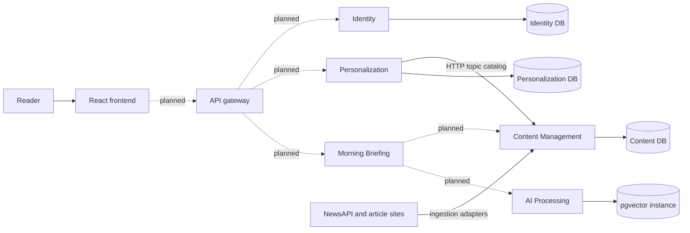

# Brief.ly

Brief.ly is a personalized morning welcome station designed to help you start
the day with clarity and warmth. It helps you keep up with technology trends
through news chosen around your interests, then offers a focus session tailored
to your day. AI organizes these moments into a gentle morning ritual for
reading, planning, and getting started.

## 1. The project

The goal is to make the first part of the day easier to navigate. Brief.ly brings together a reader's interests, relevant technology news, and a focused plan for the day. The intended journey is simple: create an account, choose topics, read a personalized briefing, and begin a focus session.

Brief.ly is a web application built with **React and TypeScript** on the frontend and **Python and FastAPI** on the backend. The product is still being developed; the architecture and individual services are further along than the complete user journey.

## 2. Architecture and service design

### Domain Driven Design and service boundaries

We use **Domain Driven Design (DDD)** to organize the backend around business capabilities. Each service owns its language, rules, and data:

| Service | Owns | Role in Briefly |
| --- | --- | --- |
| **Identity** | Accounts, credentials, and sessions | Establishes who the reader is |
| **Personalization** | Profiles and topic interests | Records what matters to the reader |
| **Content Management** | Topics, sources, and articles | Discovers and normalizes news |
| **AI Processing** | Planned AI workflows | Will enrich content for the morning experience |
| **Morning Briefing** | Planned briefing workflows | Will assemble the reader's daily briefing |

The boundaries are visible in the code. Identity's [Email value object](srcs/services/identity/src/domain/value_objects/email.py) validates and normalizes an address. Personalization's [Profile entity](srcs/services/personalization/src/domain/entities/profile.py) enforces name and interest limits. Personalization checks topic IDs through a Content Management HTTP contract, rather than reading Content Management's database. Services use separate databases and migrations, even where they share a PostgreSQL server.

### Clean Architecture inside each service

DDD establishes ownership; **Clean Architecture** separates the business rules from delivery and storage:

```text
api/             FastAPI routes, request and response schemas, dependencies
  ↓
application/     Use cases and ports; orchestration and transaction boundaries
  ↓
domain/          Entities, value objects, repository contracts, domain errors
  ↑
infrastructure/  SQLAlchemy repositories, database setup, external API clients
```

For example, [RegisterAccount](srcs/services/identity/src/application/use_cases/auth/register_account.py) coordinates account creation and the initial session in one transaction. [RefreshAccountSession](srcs/services/identity/src/application/use_cases/session/refresh_account_session.py) locks the stored token, rotates it atomically, and detects reuse. [UpsertCurrentProfile](srcs/services/personalization/src/application/use_cases/upsert_current_profile.py) validates topics and updates the profile through a unit of work. [SynchronizeSources](srcs/services/content-management/src/application/synchronize_sources.py) discovers articles, avoids duplicates, and extracts normalized content through replaceable ports.

This design lets unit tests exercise domain behavior and use cases without a database, while integration tests check persistence and HTTP behavior. The [architecture guide](docs/architecture/04_backend-service-structure.md) and [ADR 0004](docs/adr/0004-adopt-clean-architecture-for-backend-services-and-feature-based-architecture-for-frontend.md) describe the dependency rule in more detail.

### System view



The frontend currently runs as a UI prototype with mock authentication and dashboard data. The gateway and complete cross service flow are planned. The proposed [gateway decision](docs/adr/0006-use-traefik-gateway-with-tls-termination-and-two-networks.md) describes TLS termination and network isolation; the current Compose setup has one default bridge network. The [API contracts](docs/api/README.md) and [architecture decision records](docs/adr/) document both implemented and intended behavior.

### Infrastructure and engineering workflow

The [Compose configuration](compose.yaml) defines five backend containers, PostgreSQL, pgvector, an Nginx served frontend, and one shot startup jobs that create databases and apply Alembic migrations. A [development override](compose.override.yaml) adds source mounts and host ports. The root [Makefile](Makefile) supports running containers locally or in a QEMU virtual machine, as well as service level test, lint, type check, and migration commands.

Pull requests to `main` use [GitHub Actions CI](.github/workflows/ci.yml) with path filtering. Frontend checks include ESLint, TypeScript, and Vitest; backend checks include Ruff, `ty`, and pytest against PostgreSQL or pgvector. [ADR 0005](docs/adr/0005-accept-non-revocable-access-tokens.md) records an explicit security tradeoff: access tokens are short lived and cannot be individually revoked, while refresh tokens are persisted and can be revoked.

## 3. Team and 42 context

Briefly is the final project of the **42 Common Core**, developed by a **team of five**. The shared repository combines product and UI work with backend domain modeling, security, databases, testing, and infrastructure. Architectural decisions are recorded as ADRs so the reasoning and tradeoffs remain reviewable as the system evolves.

## 4. Current status and roadmap

Briefly is **actively being developed**. The following reflects the repository today:

| Area | Implemented | Next work |
| --- | --- | --- |
| Identity | Registration, login, current account, refresh, and logout; Argon2 password hashes and RS256 tokens | Connect the frontend and other services to verified identity |
| Personalization | Profile read and update, with topic validation through Content Management | Replace the temporary `X-Account-Id` header with verified token authentication |
| Content Management | Topic catalog, source and article models, NewsAPI discovery and article extraction adapters | Schedule ingestion and expose article APIs |
| Frontend | Landing, sign up, login, dashboard, and shared UI components | Replace [mock session state](srcs/frontend/src/app/AuthContext.tsx) and [dashboard fixtures](srcs/frontend/src/utils/useDashboardData.ts) with live APIs |
| AI and briefing | Service scaffolds, health endpoints, and database setup | Build AI enrichment, the personalized briefing, and the focus session |
| Gateway | Architecture proposal | Implement public routing and authentication boundaries |

### Deployment, monitoring, backup, and recovery

The application **will be deployed** with **Prometheus and Grafana** for monitoring, plus **backup and recovery** procedures. This operational work is in progress. Today the repository has container and VM workflows, database migrations, health checks, and CI. Monitoring configuration, backup jobs, and a tested recovery runbook are still to be added.

### Explore the current version

To run the frontend prototype, use Node 24 and npm 11:

```bash
cd srcs/frontend
npm ci
npm run dev
```

Open `http://localhost:5173`. The current sign in and dashboard experience uses mock data.

For backend and container setup, start with [local development](README.dev.md), [Docker Compose](README.docker.md), or the [QEMU VM guide](README.dev.vm.md). Each service also exposes `GET /health` and FastAPI's `/docs` when running. The next major milestone is to connect the existing UI and backend capabilities into one end to end reader journey, then complete briefing generation and the operational deployment.
