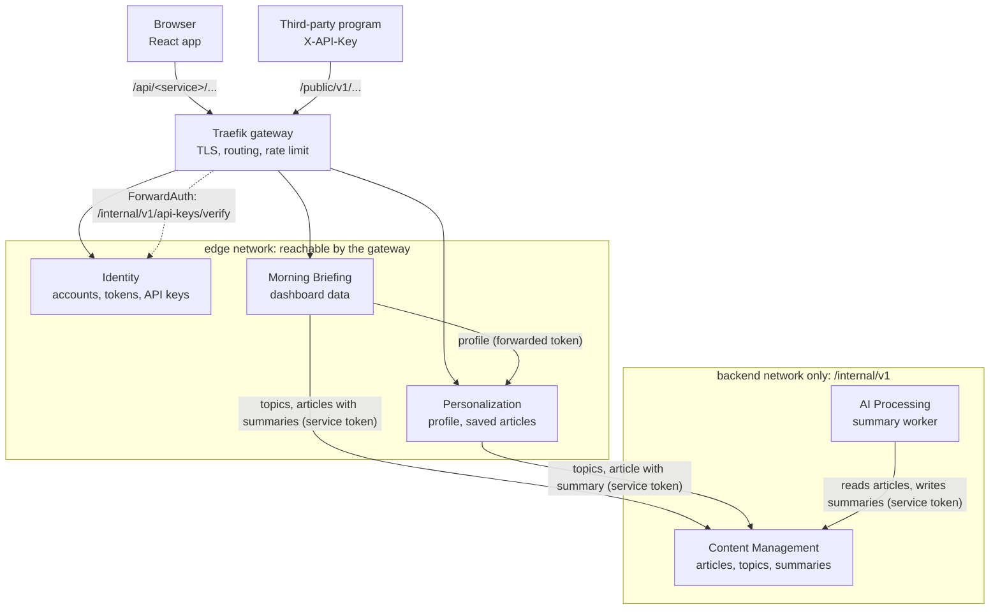

# Service-to-service calls and summaries

How the services call each other, which token each call uses, and how summaries travel from AI Processing to the readers. Conventions, tokens and errors are in [00_conventions.md](00_conventions.md).

## Who calls whom

The browser and third-party programs only ever talk to Traefik. Traefik reaches Identity, Personalization, Morning Briefing and the frontend (`edge` network). Services call each other directly (`backend` network). Content Management and AI Processing are only on `backend`.



| Caller | Callee | Endpoint | Token | Why |
| --- | --- | --- | --- | --- |
| Traefik | Identity | `/internal/v1/api-keys/verify` | none (the API key is in the headers) | Turn an API key into a public API token (phantom token pattern) |
| Personalization | Content Management | `GET /internal/v1/topics` | Service | Validate `topic_ids`, resolve topic names (cached) |
| Personalization | Content Management | `GET /internal/v1/articles/{article_id}` | Service | Check the article exists and is not rejected, then snapshot it with its summary on save |
| Morning Briefing | Personalization | `GET /internal/v1/me/profile` | User (forwarded: access token or public API token) | Interests and saved articles |
| Morning Briefing | Content Management | `GET /internal/v1/topics`, `GET /internal/v1/articles?topic_id=` | Service | All topics and their non-rejected articles, with their summaries |
| AI Processing | Content Management | `GET /internal/v1/articles?summary=missing`, `GET /internal/v1/topics`, `GET /internal/v1/articles?topic_id=` | Service | Articles without summary rows, then all topics using their non-rejected articles |
| AI Processing | Content Management | `PUT /internal/v1/articles/{article_id}/summary`, `PUT /internal/v1/topics/{topic_id}/summary` | Service (`summaries:write`) | Store the summaries |
| Any service | Identity | `POST /internal/v1/oauth/token` | Client id + secret (HTTP Basic) | Get a service token; which client may ask for which audience and scopes: `srcs/services/identity/src/infrastructure/oauth/service_clients.py` |

**Which token for which call.** A service forwards the user's token only to a service that holds **that user's** data (Morning Briefing → Personalization). For data that belongs to no user (Content Management), it uses its own service token, even while it is handling a user's request. So Content Management only ever sees service tokens, and a user's token can only expire on the first call of a chain.

**Timeouts.** Every internal call has a timeout, so a slow or stopped service gives a `503` instead of a request that hangs. Personalization's clients for Content Management use 2 s for now. They will move to shared_auth's `DownstreamClient`, which uses 5 s by default, when the service token is wired. Both stay under the frontend's 10 s, so the browser gets the `503` before it gives up.

---

## Summaries: an enrichment pipeline

### The pattern

Summaries follow the **enrichment pipeline** pattern (ADR-0010): a worker reads records from the service that owns them (the *system of record*), computes extra information, and **writes it back** to that service. Everyone else reads the enriched records from the system of record and never talks to the worker.

| Role | Here |
| --- | --- |
| System of record | Content Management: owns articles and topics, and stores their summaries |
| Worker (enricher) | AI Processing: computes summaries with the LLM, stores nothing it produces for others |
| Readers | Morning Briefing and Personalization: read articles and topics, summaries included, from Content Management |

Related name to look up: the **Content Enricher** pattern in *Enterprise Integration Patterns* (Hohpe and Woolf) describes the same idea for messages: add missing data to a message before passing it on.

### Workflow

```
1. INGESTION (manual)
   Content Management ──fetch──▶ NewsAPI
   stores new articles with summary = null

2. SUMMARY RUN (manual: make summarize)
   AI Processing ──GET /internal/v1/articles?summary=missing──▶ Content Management   max 25, no cursor
   AI Processing ──article content and language──▶ LLM ──▶ summary
   AI Processing ──PUT /internal/v1/articles/{id}/summary──▶ Content Management   stores it
   AI Processing ──PUT /internal/v1/topics/{id}/summary────▶ Content Management   stores it
   repeat the article loop until the GET returns an empty list or AI Processing
   reaches 3 consecutive failures to add a summary; a successful write resets
   the global failure counter
   (this failure definition is provisional and may change during development)
   for a rejected article, AI Processing writes text=null and rejected=true;
   Content Management returns summary=null and read_time_minutes=0
   the rejected article retains its summary row for deduplication and is not
   selected again by summary=missing; topic article lists exclude it

3. DASHBOARD (each request)
   Morning Briefing ──GET /internal/v1/me/profile──▶ Personalization   (user token)
   Morning Briefing ──GET /internal/v1/topics, /internal/v1/articles?topic_id=──▶ Content Management   (service token)
   the topics and articles arrive with their summaries
   rejected articles are absent; the topic catalog remains complete

4. SAVE AN ARTICLE
   Personalization ──GET /internal/v1/articles/{id}──▶ Content Management   (service token)
   the article arrives with its summary → copied into the saved-article snapshot
   a rejected article returns ARTICLE_NOT_FOUND and cannot be newly saved
```

### How each service gets a summary

| Service | How it gets summaries | Calls AI Processing? |
| --- | --- | --- |
| Morning Briefing | In the article and topic objects returned by Content Management | No |
| Personalization | In the article returned by Content Management, copied into the saved-article snapshot at save time | No |
| Frontend | In the briefing and saved-articles responses | No |
| Content Management | Receives them from AI Processing (`PUT .../summary`) | No (it is called) |

### Advantages

- **The dashboard keeps working when AI Processing is down**: nothing calls AI Processing during a request.
- **Each summary is computed once** and read by every service from the same place.
- **Fewer calls per dashboard load**: articles arrive with their summaries, so a dashboard load makes at most 6 internal calls (1 profile, 1 topic list, 1 article list per interest, max 4) instead of about 50 (one summary call per article and per topic to AI Processing).
- **AI Processing can change how it summarizes** (another LLM, RAG over its embeddings) without changing this contract: Content Management only ever receives a `PUT .../summary`.
- **Simpler dependency graph**: Content Management still calls nobody; Morning Briefing and Personalization no longer depend on AI Processing.

### Disadvantages

- **Summaries exist only after a run.** An article ingested since the last `make summarize` has `summary: null`; the frontend must handle it (hide the article or show "summary coming soon").
- **Content Management stores data it does not produce**, so its database needs summary columns (a migration) and two write routes.
- **Only the latest topic summary is kept**; there is no history.
- **A saved article keeps the summary it had when saved.** If AI Processing later rewrites the summary, the saved copy does not change.
- **Summaries are not computed on demand**: a user can't ask for a summary that doesn't exist yet.
